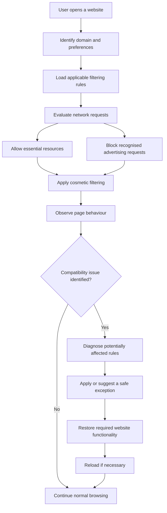
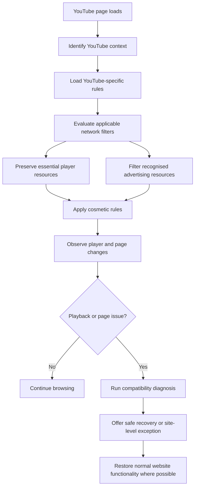
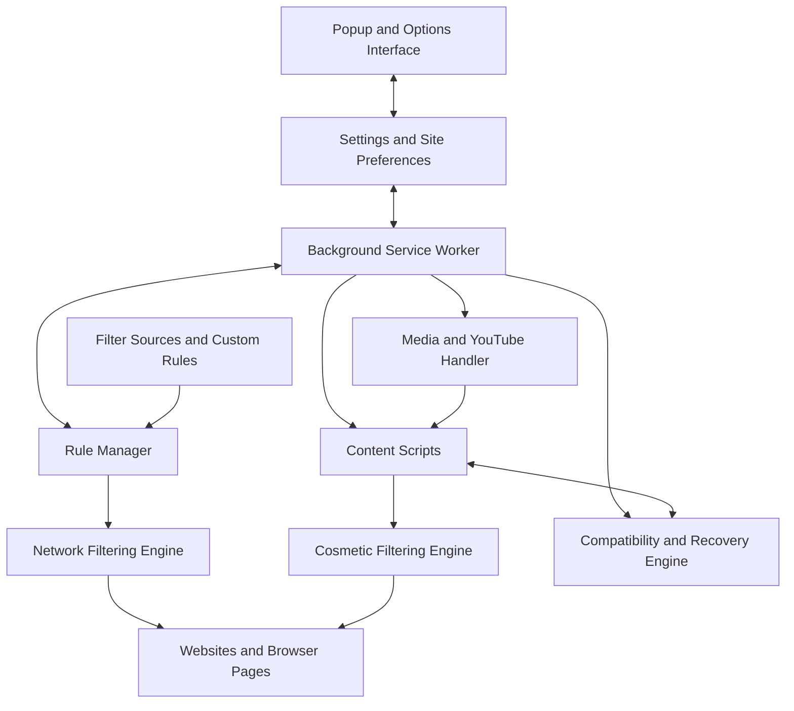

# BipBuster

  <strong>Intelligent Ad Blocking. Cleaner Browsing. Better Compatibility.</strong>

  A privacy-focused browser extension designed to reduce intrusive advertising, limit unwanted tracking, and preserve the functionality of the websites people use every day.

---

## Overview

**BipBuster** is a Chromium browser extension that combines network-level filtering with cosmetic filtering and site-compatibility controls.

Traditional ad blockers can sometimes interfere with legitimate website resources. When a page depends on a blocked script, request, or embedded component, the result may be a broken layout, missing functionality, or an anti-adblock warning.

BipBuster addresses this problem through a more selective filtering approach:

- Block recognised advertising and ad-serving requests.
- Reduce unwanted tracking according to the user's settings.
- Remove advertising elements while preserving legitimate content.
- Keep essential website resources available.
- Provide site-specific controls and recovery options.
- Apply dedicated compatibility handling to media-heavy sites such as YouTube.

BipBuster does not claim to be undetectable on every website. Websites can change their detection systems, and some platforms may restrict playback or access when advertising is blocked. Compatibility focuses on avoiding unnecessary breakage and recovering functionality where possible—not falsifying ad impressions or pretending that advertisements were viewed.

## Key Features

| Feature | Description |
|---|---|
| Network filtering | Blocks recognised advertising and selected tracking requests. |
| Cosmetic filtering | Hides identified advertising elements and cleans up unnecessary page space. |
| Compatibility controls | Provides site-level settings, exceptions, and recovery options. |
| YouTube-specific handling | Uses dedicated page handling to preserve normal player functionality where possible. |
| Filter management | Supports maintained filter sources and custom rules where compatible. |
| Per-site preferences | Allows filtering behaviour to be adjusted for individual websites. |
| Local settings | Stores user preferences locally through browser storage. |
| Lightweight operation | Uses browser-native APIs and efficient event-driven page observation. |

## How BipBuster Works

BipBuster uses multiple filtering layers. Each layer has a separate responsibility, allowing the extension to block unwanted advertising without treating every third-party resource as an advertisement.

### 1. Network-Level Filtering

The network filtering layer evaluates browser requests against configured rules.

Requests are classified by their purpose and context. Recognised advertising and ad-serving requests can be blocked, while essential resources—such as authentication, core application scripts, APIs, and video streams—should remain available unless a specific, justified rule applies.

The filtering policy distinguishes between:

- Advertising and ad-serving resources.
- Tracking resources governed by privacy settings.
- Analytics resources that may be required for site functionality.
- Essential application resources.
- Media, authentication, and content-delivery resources.

Chrome's Declarative Net Request API applies supported rules through the browser. This provides an efficient, browser-managed approach to request filtering without requiring unrestricted interception of all network traffic.

### 2. Cosmetic Filtering

Blocking an advertising request does not necessarily remove the space reserved for its advertisement. The cosmetic filtering layer handles the visible page.

It identifies known advertising containers and applies carefully scoped cosmetic rules to remove them from the page.

Its responsibilities include:

- Hiding recognised advertising elements.
- Removing empty advertising placeholders where safe.
- Cleaning up unnecessary blank areas.
- Preserving legitimate content and interactive controls.
- Handling dynamically inserted elements.

Cosmetic rules must be specific enough to avoid hiding ordinary content simply because an element has a class or identifier containing words such as `ad` or `advert`.

### 3. Adaptive Compatibility Strategy

The central compatibility principle is **selective filtering rather than indiscriminate blocking**.

Some websites depend on third-party resources that may initially look similar to advertising or tracking resources. Blocking those resources can cause functionality problems.

BipBuster's compatibility approach is designed around the following process:

The compatibility layer can use site-specific preferences, rule exceptions, and temporary protection suspension to help recover a page.

This is not a guarantee that every anti-adblock system can be bypassed. If a website deliberately restricts access when filtering is active, BipBuster should provide an honest compatibility option rather than simulate a successful advertisement view.

### 4. Dynamic Page Handling

Modern websites frequently change their page structure after the initial load. They may insert new components, update content without a full page reload, or navigate through a single-page application.

BipBuster uses page-level observation where required to detect relevant DOM changes and apply cosmetic rules to newly inserted elements.

Mutation observation should be scoped and efficient to avoid excessive CPU usage, repeated scans, or unnecessary processing.

## YouTube Compatibility

YouTube requires dedicated handling because its interface and playback experience are more complex than those of a typical static website.

BipBuster separates YouTube-specific page handling from its general website filtering logic.

The YouTube compatibility layer is designed to:

- Identify known advertising-related page elements.
- Apply carefully scoped cosmetic filtering.
- Preserve the video player and playback controls.
- Avoid unnecessarily blocking video streams and essential player resources.
- Handle dynamically changing player and page elements.
- Preserve normal navigation and interaction.
- Avoid forced seeking, artificial playback events, or fabricated ad-view signals.

### YouTube Processing Flow

**Important:** YouTube controls its own advertising and playback systems. Its detection mechanisms and policies can change. BipBuster does not guarantee uninterrupted ad-free playback or promise to defeat every platform restriction.

## Website Compatibility

BipBuster is intended for general-purpose browsing across different categories of websites.

| Website category | Filtering approach |
|---|---|
| Search engines | Advertising and cosmetic filtering with essential search functionality preserved. |
| News websites | Advertising removal while preserving articles, navigation, and content. |
| Blogs and content sites | Cosmetic and network filtering with layout preservation. |
| Shopping websites | Selective advertising filtering while retaining product, cart, and checkout functionality. |
| Social platforms | Site-specific filtering where compatible with dynamic page behaviour. |
| Video platforms | Media-aware filtering and dedicated compatibility handling. |
| Banking websites | Conservative filtering to minimise interference with authentication and essential operations. |

Compatibility depends on each website's implementation and may change as websites update their code.

## Filtering Modes

BipBuster is designed around three operating modes:

### Balanced Mode

The recommended everyday mode. Blocks recognised advertising resources and applies conservative cosmetic filtering while prioritising website functionality.

### Strict Mode

Applies stronger advertising and tracking filters. It may increase the possibility of website compatibility issues.

### Compatibility Mode

Reduces filtering on a problematic website through site-specific exceptions or temporary protection suspension. It is intended to restore normal browsing when filtering interferes with website functionality.

The availability and exact behaviour of these modes depend on the implemented extension settings and filtering rules.

## Architecture

BipBuster follows a modular, browser-native architecture.

### Architectural Responsibilities

| Component | Responsibility |
|---|---|
| Popup Interface | Provides quick protection controls and current-site settings. |
| Options Interface | Manages preferences, filtering modes, and configuration. |
| Background Service Worker | Coordinates extension operations and browser events. |
| Rule Manager | Loads, prioritises, and updates filtering rules. |
| Network Filtering Engine | Applies supported network filtering rules. |
| Cosmetic Filtering Engine | Removes identified advertising elements from rendered pages. |
| Compatibility Engine | Diagnoses filtering-related issues and manages recovery options. |
| Media Handler | Coordinates dedicated media-site handling. |
| YouTube Handler | Applies YouTube-specific compatibility and cosmetic logic. |
| Content Scripts | Interact with permitted page contexts and dynamic DOM elements. |
| Filter Sources | Supply maintained and custom filtering rules. |

## The Core Technique: Layered Filtering and Compatibility Recovery

BipBuster's main engineering approach is to combine three complementary techniques:

**1. Network filtering:** Prevent recognised advertising resources from loading.

**2. Cosmetic filtering:** Remove corresponding advertising elements and unnecessary placeholders from the rendered page.

**3. Compatibility recovery:** When filtering interferes with a website, identify potentially responsible rules and restore the resources or functionality required by that site.

The advantage of this layered approach is that network filtering and page presentation are handled separately. A blocked advertising request does not automatically require removing an entire page section, and a cosmetic rule does not need to interfere with essential network resources.

This approach reduces avoidable compatibility problems. It does not make an extension invisible to websites, and it does not guarantee that all anti-adblock checks will be satisfied.

## Technology Stack

| Technology | Usage |
|---|---|
| JavaScript (ES6+) | Extension logic and filtering engines. |
| HTML5 | Popup and settings interfaces. |
| CSS3 | Interface styling and cosmetic filtering. |
| Chrome Extension Manifest V3 | Extension platform and permission model. |
| Declarative Net Request API | Browser-managed network filtering. |
| Content Scripts | Website-specific page interaction. |
| MutationObserver | Efficient observation of dynamic DOM changes. |
| Chrome Storage API | Local preferences and configuration. |
| Playwright | Automated browser and compatibility testing. |
| JSON | Filtering rules and configuration data. |
| EasyList | Advertising filter source. |
| EasyPrivacy | Privacy and tracking filter source. |

Filter-list compatibility depends on the supported syntax and the browser's available rule capabilities. Unsupported rules must be handled explicitly rather than assumed to work.

## Privacy and Security

BipBuster is designed with a local-first approach.

- User preferences are stored through browser storage.
- Filtering is performed within the extension and browser.
- No advertising-view events are fabricated.
- No passwords, authentication tokens, or form contents should be collected for filtering purposes.
- Extension permissions should be limited to those required by its features.
- Filter sources and updates should be handled transparently.
- Essential website functionality should not be disabled without a clear reason.

Users should review the permissions requested by the installed extension and the privacy practices of any external filter source.

## Performance Principles

BipBuster aims to minimise the impact of filtering on browsing performance.

- Prefer browser-native declarative request filtering.
- Avoid unnecessary polling and continuous DOM scans.
- Use event-driven observation where practical.
- Scope DOM observers to relevant page elements.
- Avoid duplicate filtering rules.
- Keep page-specific logic isolated.
- Avoid unnecessary network calls and background processing.

## Installation

For local development:

1. Clone or download the project.
2. Open Chrome and navigate to `chrome://extensions/`.
3. Enable **Developer mode**.
4. Select **Load unpacked**.
5. Choose the extension's project directory.
6. Pin BipBuster to the browser toolbar.
7. Open a website and verify the extension's filtering behaviour.

For development changes, use the **Reload** control on the extension card to reload the unpacked extension.

## Testing and Validation

A release should be tested across different website categories rather than judged solely by the number of blocked requests.

| Test area | Validation |
|---|---|
| Network filtering | Correct advertising requests are blocked. |
| Essential resources | Authentication, APIs, and core scripts continue working. |
| Cosmetic filtering | Advertisements are removed without hiding legitimate content. |
| Layout | No unnecessary blank spaces or broken page sections. |
| YouTube | Player controls, navigation, and normal playback remain functional where permitted. |
| Compatibility recovery | Site-specific exceptions restore affected functionality. |
| Performance | No excessive CPU or memory usage. |
| Privacy | No unnecessary collection or transmission of browsing data. |
| Regression | Existing settings and features continue working after updates. |

## Limitations

- No ad blocker can guarantee compatibility with every website.
- Websites can change their DOM, advertising delivery, and anti-adblock mechanisms at any time.
- Some websites may restrict access or playback when advertising is blocked.
- Manifest V3 imposes limits on network filtering and rule management.
- Not every third-party filter-list rule is supported by the browser.
- Compatibility recovery may require a site-specific exception or temporary suspension of filtering.

## Project Philosophy

BipBuster is built around a simple principle:

> Block intrusive advertising. Preserve the actual website. Give users control.

The objective is not to break websites or manipulate advertising measurement systems. It is to provide a cleaner browsing experience through selective filtering, efficient browser-native technology, and responsible compatibility handling.

---

  <strong>BipBuster</strong> 
  Browse Clean. Browse Freely.

